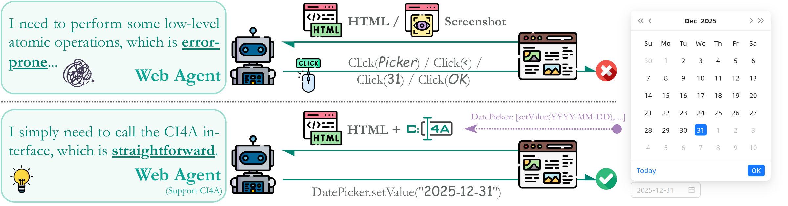

# CI4A：面向智能体的语义组件接口，赋能 Web 自动化

**通过组件级语义交互，构建人类与智能体共生的 Web 生态。**

[English](README.md) · [快速开始](#快速开始) · [运行 Eous](#运行-eous) · [目录结构](#目录结构)

CI4A（**Component Interface for Agent**）是一种语义封装协议，通过结构化状态、可执行工具和显式交互元数据，将 UI 组件的交互能力提供给智能体。本仓库整合了三套组件库实现、**Eous** 智能体，以及各组件库对应的 WebArena 环境。

## 为什么从组件出发？

Web 自动化需要将高层任务意图落实为应用状态的具体变化。现代界面通过日期选择器、表格、表单、菜单和对话框等组件组织交互，每个组件本身就包含明确的状态、操作能力和约束。

CI4A 将这些语义直接提供给智能体：组件说明自身包含哪些信息、支持哪些操作，以及如何调用这些操作。智能体由此获得理解和操作页面的原生接口，而组件仍然是面向人类用户的应用界面的一部分。



*论文 Figure 1。日期选择器展示了用户意图与组件操作之间的联系：智能体发现可用接口后，通过 `DatePicker.setValue("2025-12-31")` 表达期望的状态变化。此处调用是图中的概念示例。*

## CI4A 协议与 Eous

每个 CI4A 组件向智能体暴露语义三元组 **⟨S, T, M⟩**：

| 接口 | 提供的内容 |
|---|---|
| **S — 语义状态视图** | 来自组件内部数据模型的结构化状态，包括当前渲染视图中尚未显示的相关信息。 |
| **T — 可执行工具集** | 封装组件状态变化的可调用操作，例如选择日期、更新字段。 |
| **M — 交互元数据** | 工具描述和参数约束，包括类型、可选值和必填字段。 |

组件将接口注册到页面级注册表。**Eous** 发现这些接口，将组件状态和工具 Schema 纳入页面观察，并随页面变化动态更新可用动作。它结合组件级工具调用与底层交互回退，支持视觉和结构两种观察模式。

仓库提供覆盖 Vue 和 React 生态的三套实现：

| 实现 | 组件框架 | 组件库源码 | WebArena 应用 |
|---|---|---|---|
| **AntDX** | Ant Design Vue | [AntDX](AntDX/) | [WebArenaX](WebArenaX/) |
| **MaterialX** | Material UI / React | [MaterialX](MaterialX/) | [WebArenaX-MaterialX](WebArenaX-MaterialX/) |
| **ElementX** | Element Plus / Vue | [ElementX](ElementX/) | [WebArenaX-ElementX](WebArenaX-ElementX/) |

每套实现还提供独立组件测试页。三个 WebArena 前端共用基于 MySQL 的 API，构成用于**基础设施增强条件下评测（infrastructure-enabled evaluation）**的 CI4A 集成环境。公开版包含五个示例任务，用于体验完整交互流程。

## 迈向人类与智能体共生的 Web 生态

我们的愿景是让 Web 应用对智能体和人类同样友好。CI4A 希望将显式的组件语义发展为前端基础设施中可复用的一部分，使应用在提供人类交互界面的同时，也能提供原生、稳定的智能体交互通道。我们欢迎组件库、应用和智能体开发者共同探索这一方向。

我们期待组件库将语义接口带入使用它们构建的应用，让智能体能够在不同任务中发现并使用这些接口。随着生态逐步发展，可复用的组件契约有望成为可审计、可治理的交互基础，连接应用开发者、智能体开发者与用户，共同建设原生友好的 Agentic Web。

## 快速开始

需要 Node.js 22.12+、pnpm 10.28.0、Python 3.11+。当前验证环境为 Windows、Node 24 和 Python 3.13；其他平台尚未独立验证。

在仓库根目录执行：

```powershell
powershell -NoProfile -File scripts/setup.ps1
pnpm dev:components
```

Linux/macOS 可使用 `bash scripts/setup.sh`。安装脚本会安装依赖、构建 MaterialX 运行包、安装 Chromium，并在需要时从 `.env.example` 创建 `.env`，不会调用模型。

保持开发服务运行，然后打开组件页；组件页无需数据库或模型密钥。

| 环境 | AntDX | MaterialX | ElementX |
|---|---|---|---|
| 组件测试页 | [5283](http://127.0.0.1:5283/) | [5284](http://127.0.0.1:5284/) | [5285](http://127.0.0.1:5285/) |
| WebArena（需要数据库） | [5273](http://127.0.0.1:5273/) | [5274](http://127.0.0.1:5274/) | [5275](http://127.0.0.1:5275/) |

## 运行 WebArena

WebArena 需要共享 API 和兼容的 Magento/WebArena 数据库。**仓库不包含数据库快照**，请自行提供有权使用的数据，并在被 Git 忽略的 `.env` 中设置 `DB_*`。

可选 Docker 方式：将自己的未压缩 SQL 文件放入 `data/private/bootstrap.sql`，设置非空的 `DB_PASSWORD` 和 `MYSQL_ROOT_PASSWORD`，执行 `docker compose up -d mysql`。仅在数据卷首次初始化时导入 SQL。当前 Windows 环境尚未验证 Docker 方式，请使用独立研究数据库。

```powershell
pnpm dev:webarena
# 或同时启动六个前端及共享 API：
pnpm dev
```

API 健康检查：[127.0.0.1:5000/api/health](http://127.0.0.1:5000/api/health)。数据库不可用时 API 会明确报告，不会生成替代数据。默认服务仅监听本机回环地址，适用于本地研究。端口被占用时启动会报错，可停止对应旧服务或在 `.env` 调整端口。

## 运行 Eous

实际调用模型前，在 `.env` 设置 `EOUS_API_KEY`、`EOUS_API_BASE` 和 `EOUS_MODEL`。运行会向配置的服务商发送页面观察，并可能产生模型费用；日志和截图应保留在本地。

```powershell
# 无模型调用：检查组件页上的感知能力。
.\.venv\Scripts\python.exe Eous/run.py --library materialx --probe --headless

# 运行 WebArena 示例，需要数据库和模型配置。
.\.venv\Scripts\python.exe Eous/run.py --library antdx --target webarena --task-id 0 --headless

# 切换组件库，并使用结构观察模式。
.\.venv\Scripts\python.exe Eous/run.py --library elementx --target webarena --task-id 11 --mode structure --headless
```

Linux/macOS 使用 `.venv/bin/python`。输出位于被忽略的 `runs/`，实际智能体日志位于每次运行目录中的 `log/eous_sys_log.log`。`--probe` 不调用模型。运行结束不等于通过正式评测，`benchmark_evaluated` 保持为 false。

### 五个示例任务

| ID | 查询内容 |
|---|---|
| 0 | 2022 年最畅销商品 |
| 1 | 2022 年第一季度最畅销品牌 |
| 11 | 包含“disappointed”的评论数量 |
| 107 | 2022 年 5–12 月每月成功订单数量 |
| 108 | 2023 年 1–5 月每月成功订单数量 |

任务保留原查询意图和参考答案，仅调整重建环境的 URL 与登录态元数据。答案依赖实际数据库；之前的本地数据曾与任务 0 的参考答案不一致。因此，这些示例不保证在任意数据上通过，也不能用于声称复现论文分数。

## 验证

```powershell
pnpm build
pnpm smoke
.\.venv\Scripts\python.exe -m unittest discover -s tests
python scripts/release_audit.py
```

Smoke 检查需要对应的本地环境运行。若检查生产构建，请先停止开发服务，再执行 `node scripts/dev.mjs --preview`。完整上游组件测试套件和原始全量任务集不在此次公开版验证范围内。

## 目录结构

| 路径 | 内容 |
|---|---|
| `Eous/` | 智能体、Citlali 运行时、感知与动作执行、统一 CLI |
| `AntDX/`、`MaterialX/`、`ElementX/` | 组件库完整源码、测试、构建工具及上游文档 |
| `runtime-packages/` | 默认可运行工作区使用的本地发行包 |
| `WebArenaX/` | AntDX 前端及共享 MySQL API |
| `WebArenaX-MaterialX/`、`WebArenaX-ElementX/` | MaterialX 和 ElementX 前端 |
| `examples/components/` | 三套独立组件测试页 |
| `tasks/webarena/` | 仅五个示例任务：0、1、11、107、108 |

默认 pnpm 工作区使用 `runtime-packages/` 中的包。组件库完整源码保留各自的测试、构建和文档体系，与默认可运行工作区区分组织。

## 发布范围与许可证

公开版包含 Eous、三个组件库及其组件测试页和 WebArena 应用、五个 WebArena 示例任务。不包含私有数据库、凭据、登录态、运行轨迹或私有开发历史。请勿将 `.env`、`data/private/` 和生成的 `runs/` 加入 Git。

验证范围见[发布审计](docs/RELEASE_AUDIT.md)，许可证归属见[第三方说明](THIRD_PARTY_NOTICES.md)。现有第三方许可证继续有效；CI4A/Eous 新增代码的统一项目许可证尚未由权利人指定。
