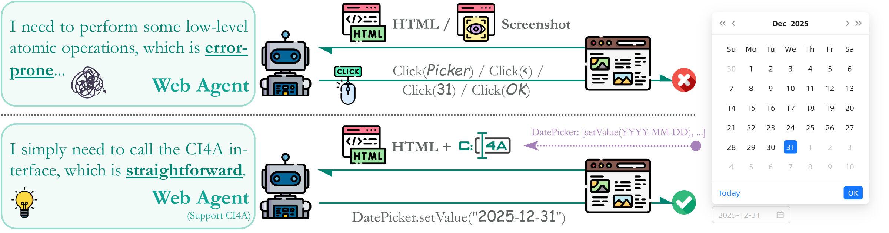

# CI4A: Semantic Component Interfaces for Agents Empowering Web Automation

**Component-level semantic interaction for a Web ecosystem shared by humans and agents.**

[中文](README-zh_CN.md) · [Quick start](#quick-start) · [Run Eous](#run-eous) · [Repository layout](#repository-layout)

CI4A (**Component Interface for Agent**) is a semantic encapsulation protocol that makes UI components accessible to agents through structured state, executable tools, and explicit interaction metadata. This repository brings together the protocol's three component-library implementations, the **Eous** agent, and their corresponding WebArena environments.

## Why component interfaces?

Web automation connects high-level task intents with concrete changes in an application's state. Modern interfaces organize those interactions through components: date pickers, tables, forms, menus, and dialogs. Each component already carries meaningful state, operations, and constraints.

CI4A makes these semantics directly available to agents. A component exposes what it contains, which operations it supports, and how those operations should be invoked. This gives agents a native interface for understanding and acting on the page, while keeping components part of the familiar human-facing application.



*Figure 1 from the paper. A date picker illustrates the connection between a user intent and a component operation: the agent discovers the available interface and invokes `DatePicker.setValue("2025-12-31")` to express the intended state change. The invocation shown is a conceptual example from the figure.*

## The CI4A protocol and Eous

Each CI4A component exposes a semantic triplet **⟨S, T, M⟩**:

| Interface | What it provides |
|---|---|
| **S — Semantic State View** | Structured state from the component's internal data model, including relevant information not currently visible in its rendered view. |
| **T — Executable Toolset** | Callable component operations that encapsulate state changes, such as selecting a date or updating a field. |
| **M — Interaction Metadata** | Tool descriptions and parameter constraints, including types, allowed values, and required fields. |

Components register their interfaces with a page-level registry. **Eous** discovers these interfaces, incorporates their state and tool schemas into its page observations, and updates its available actions as the page changes. It combines component-level tool calls with low-level interaction fallbacks and supports both visual and structural observation modes.

The repository includes implementations across the Vue and React ecosystems:

| Implementation | Component framework | Library source | WebArena application |
|---|---|---|---|
| **AntDX** | Ant Design Vue | [AntDX](AntDX/) | [WebArenaX](WebArenaX/) |
| **MaterialX** | Material UI / React | [MaterialX](MaterialX/) | [WebArenaX-MaterialX](WebArenaX-MaterialX/) |
| **ElementX** | Element Plus / Vue | [ElementX](ElementX/) | [WebArenaX-ElementX](WebArenaX-ElementX/) |

Each implementation also has a standalone component playground. The three WebArena frontends share a MySQL-backed API. They provide **CI4A-integrated environments for infrastructure-enabled evaluation**; this public release includes five example tasks for exploring the interaction workflow.

The WebArena adaptations in this repository provide only partial reference implementations; they do not include the complete reconstructed environment or task set.

## Towards a symbiotic Web ecosystem

Our vision is a Web that is as friendly to agents as it is to humans. CI4A aims to make explicit component semantics a reusable part of frontend infrastructure, allowing applications to expose a native, stable interaction channel alongside their human-facing interfaces. We welcome adoption and experimentation across component libraries, applications, and agent runtimes.

We envision component libraries carrying these semantic interfaces into the applications built with them, and agents discovering and using those interfaces across tasks. As this ecosystem grows, reusable component contracts can provide a foundation for auditable and governable interactions, supporting collaboration between application developers, agent builders, and users.

## Quick start

Requirements: Node.js 22.12+, pnpm 10.28.0, and Python 3.11+. The current validation uses Windows, Node 24 and Python 3.13; other platforms have not been independently validated.

```powershell
# From the repository root, Windows:
powershell -NoProfile -File scripts/setup.ps1
pnpm dev:components
```

On Linux/macOS, use `bash scripts/setup.sh` (not independently tested). The setup installs dependencies, builds the MaterialX runtime, installs Chromium, and copies `.env.example` to `.env` if necessary. No model is called during setup.

Keep the dev server running and open a playground; these pages require neither a database nor a model key.

| Environment | AntDX | MaterialX | ElementX |
|---|---|---|---|
| Component playground | [5283](http://127.0.0.1:5283/) | [5284](http://127.0.0.1:5284/) | [5285](http://127.0.0.1:5285/) |
| WebArena (requires database) | [5273](http://127.0.0.1:5273/) | [5274](http://127.0.0.1:5274/) | [5275](http://127.0.0.1:5275/) |

## Run WebArena

The frontends require the shared API and a compatible Magento/WebArena database. **No database snapshot is published:** recovered databases may contain personal data, credentials or experimental state. Bring a database you are authorized to use and configure `DB_*` in your ignored `.env`.

For a new isolated Docker database, place your own uncompressed SQL dump at `data/private/bootstrap.sql`, set non-empty `DB_PASSWORD` and `MYSQL_ROOT_PASSWORD`, then run `docker compose up -d mysql`. The dump is imported only when the Docker data volume is first initialized. Docker is an optional path and has not been tested in the current Windows environment. Do not point this at a production database.

```powershell
pnpm dev:webarena
# Or start all six frontends plus the API:
pnpm dev
```

The WebArena URLs are listed above. API health: [127.0.0.1:5000/api/health](http://127.0.0.1:5000/api/health). The API reports unavailable when the database is missing; it does not substitute fabricated results. All default app listeners bind to loopback. These are research environments, not hardened public hosting services.

## Run Eous

Set `EOUS_API_KEY`, `EOUS_API_BASE`, and `EOUS_MODEL` in `.env` for actual model calls. Runs send page observations to the configured model provider and can incur provider charges. Keep generated logs and screenshots private.

```powershell
# No model call: check perception on a component playground.
.\.venv\Scripts\python.exe Eous/run.py --library materialx --probe --headless

# Run one of the five WebArena examples; requires a working database.
.\.venv\Scripts\python.exe Eous/run.py --library antdx --target webarena --task-id 0 --headless

# Select another library / use structure mode.
.\.venv\Scripts\python.exe Eous/run.py --library elementx --target webarena --task-id 11 --mode structure --headless
```

On Linux/macOS, use `.venv/bin/python`. Outputs go to ignored `runs/`. Actual agent logs are in `log/eous_sys_log.log` within each run. `--probe` never calls a model. Runtime completion is **not** benchmark evaluation: `benchmark_evaluated` stays false.

### Bundled example tasks

| ID | Query |
|---|---|
| 0 | Best-selling product in 2022 |
| 1 | Best-selling brand in the first quarter of 2022 |
| 11 | Number of reviews mentioning “disappointed” |
| 107 | Monthly successful-order counts, May–December 2022 |
| 108 | Monthly successful-order counts, January–May 2023 |

The five examples preserve the original query intents and reference answers. Only their start URL and login-state metadata were adapted to these reconstructed applications. Answers depend on the supplied dataset. A previous local dataset produced an answer different from task 0's reference; do not treat these examples as guaranteed passing benchmarks or use them to claim the paper's scores.

## Checks

```powershell
pnpm build
pnpm smoke
.\.venv\Scripts\python.exe -m unittest discover -s tests
python scripts/release_audit.py
```

Smoke requires the corresponding local environments to be running. Stop dev services before `node scripts/dev.mjs --preview`; it serves the production builds. Full upstream component test suites and the full original task set are outside this release validation.

## Repository layout

| Path | Purpose |
|---|---|
| `Eous/` | Agent, Citlali runtime, perception, action execution, and unified CLI |
| `AntDX/`, `MaterialX/`, `ElementX/` | Library source trees, tests, build tooling, and upstream documentation |
| `runtime-packages/` | Local distributable packages used by the runnable workspace |
| `WebArenaX/` | AntDX frontend and shared MySQL-backed API |
| `WebArenaX-MaterialX/`, `WebArenaX-ElementX/` | MaterialX and ElementX frontends |
| `examples/components/` | Three standalone component playgrounds |
| `tasks/webarena/` | Example tasks 0, 1, 11, 107, 108 only |

The default pnpm workspace uses the local packages in `runtime-packages/`. The full library source trees retain their upstream tests, build tools, and documentation; they are separate from the default runnable workspace.

## Release scope and licensing

This release includes Eous, three component libraries, their component playgrounds and WebArena applications, and exactly five WebArena example tasks. Private databases, credentials, login state, execution traces, and private development history are excluded. Keep `.env`, `data/private/`, and generated `runs/` out of Git.

See the [release audit](docs/RELEASE_AUDIT.md) for validation scope and the [third-party notices](THIRD_PARTY_NOTICES.md) for licensing. Existing third-party licenses remain authoritative; a project-wide license for the CI4A/Eous additions has not yet been specified by the rights holder.
